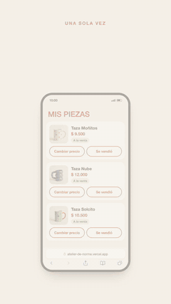

# Atelier de Norma

Tienda de cerámica para la tía Norma: 70 años, no tiene compu ni mail, ve poco y no tiene paciencia para la tecnología.
Sus clientes son más o menos como ella.

**Dos pantallas, dos públicos:**

| | Para quién | Qué hace |
|---|---|---|
| `/` | Clientes | Ven las tazas y tocan "La quiero": se abre WhatsApp con el pedido escrito. Sin cuentas, sin mail, sin carrito. |
| `/taller` | Norma | Saca una foto, le pone nombre y precio, y listo. Recibe avisos en el celular cuando alguien quiere algo. |

## En video

Tocá cada video para verlo completo y con sonido.

| Lanzamiento · 60 s | Me olvidé la clave · 22 s | El ícono en el celu · 14 s |
|:---:|:---:|:---:|
| [](docs/videos/lanzamiento.mp4) | [](docs/videos/olvide-la-clave.mp4) | [](docs/videos/icono-en-el-celu.mp4) |
| Quién es Norma, cómo se compra y cómo maneja la tienda. | Si se olvida el PIN, el celu llama a Goncy y entra con una clave nueva. | Se guarda una sola vez y Norma entra con un toque. |

Los videos están hechos con [Remotion](https://www.remotion.dev) en [`video-lanzamiento/`](video-lanzamiento). La música es original y se compone con código, nota por nota, sin IA ni samples ([`video-lanzamiento/musica/`](video-lanzamiento/musica)).

## Por qué así y no un bot de WhatsApp

La idea más obvia era que Norma administrara todo hablándole a un bot de WhatsApp. La descarté a propósito:

- **No depende de Meta.** Sin aprobación de plantillas, sin número de empresa, sin las restricciones de 2026 sobre bots con IA.
- **Cuesta $0.** Web Push es estándar del navegador.
- **Norma ve lo que toca.** No hay una IA que interprete mal "vendí el plato" y borre otra cosa.
- **Los avisos le llegan igual** a la bandeja del celular, como los de WhatsApp.

WhatsApp sigue estando donde ya funciona: **es el canal de los clientes con Norma** ("Avisale por WhatsApp", "Escribile a Marta").

## Las fotos: Norma saca la foto como le sale

Esta es la parte más importante. Una persona de 70 años no va a encuadrar bien, y no tiene por qué.

1. **Se quita el fondo en el mismo celular** con un modelo de IA que corre en el navegador (`@imgly/background-removal`). Es gratis, sin APIs, y la foto no sale del teléfono hasta que ella la sube.
2. **Si quedaron varias cosas** (por ejemplo, el celular apoyado al lado de la taza), se queda con la más grande.
3. **Se centra y se lleva a un tamaño parejo.** Da igual si la pieza quedó chica, torcida o en una esquina.
4. **Se apoya sobre fondo crema** con sombra suave, un filtro cálido y un grano leve. Así todo el catálogo se ve igual.
5. **Norma elige** entre "Así está bien" y "Dejar mi foto como la saqué". Si el recorte sale mal, la foto original recibe el mismo filtro y combina igual.
6. **Si quedaron cosas pegadas a la pieza** (el termo al lado del mate, una tijera apoyada), toca "Mostrar dónde está la pieza" y **la pinta con el dedo**. La foto se recorta alrededor de lo que pintó y se vuelve a procesar. Sin esquinas ni pellizcos: un solo gesto.

Los colores de la pieza no se tocan: el cliente tiene que ver el color real.

Código: [`src/lib/procesar-foto.ts`](src/lib/procesar-foto.ts) y [`RecortarFoto.tsx`](src/app/taller/nueva/RecortarFoto.tsx)

## Accesibilidad

- Letra base de **20 px** y botón **"Letra más grande"** que la lleva a 24 px y se recuerda.
- Tipografía **Helvetica** (Arial donde no está instalada). La parte manuscrita es solo el logo.
- **Contraste AAA (8,3:1)** en el texto principal: obispo sobre crema. El naranja se usa solo en tamaños grandes o como fondo con texto oscuro.
- Botones de **48 px o más**, una pieza por fila en el celular, sin carruseles ni pop-ups.
- Estados con **texto, no solo con color** ("Sin stock", "Reservada").
- HTML semántico, foco visible, salto al contenido, `lang="es-AR"`, `prefers-reduced-motion`.
- El panel abre el teclado directo en el campo y usa teclado numérico para precios.

## Comprar

1. "La quiero" abre **WhatsApp directo** (sin pasar por otra página) con el mensaje listo:
   "¡Hola Norma! Quiero comprar la Taza Moñitos ($ 9.500)." + el link a la taza.
2. Con el sitio publicado, WhatsApp convierte ese link en una **vista previa con la foto**, el nombre y el precio.
3. Norma contesta con el alias, cobra por transferencia y coordinan el retiro o envío.
4. En el taller toca **"Se vendió"** y la taza pasa a "Sin stock".

**Modo demo:** si `whatsapp` está vacío en `src/config.ts`, WhatsApp se abre con el pedido escrito y cada uno elige a quién mandárselo (por ejemplo, a sí mismo). Un cartelito lo explica. Para la tienda real, se carga el número de Norma.

## Avisos para Norma

Uno solo: si pasa **una semana sin tocar la tienda**, le llega "¿Sigue todo igual en el taller?". Se manda con Web Push y **Vercel Cron** (todos los días a las 10 h de Argentina).

- **Android:** funciona desde Chrome.
- **iPhone:** hay que "Agregar a inicio" una vez (iOS 16.4+). El panel lo explica paso a paso.

## Entrar al taller

PIN de 4 números con teclado grande, **una sola vez**: después la sesión queda abierta un año en ese celular.
Sin mail y sin contraseña. En el prototipo el PIN es `1234`.

## Stack

- **Next.js 15** (App Router, Server Actions) + Tailwind 4
- **Upstash Redis** (Vercel Marketplace) para los datos. En local usa `.data/db.json`.
- **Vercel Blob** para las fotos. En local, `.data/fotos/`.
- **web-push** + Service Worker para los avisos
- **Vercel Cron** para los recordatorios
- **@imgly/background-removal** para quitar el fondo en el dispositivo (licencia AGPL)

## Correr en local

```bash
npm install
npm run dev
```

- Tienda: http://localhost:3000
- Taller: http://localhost:3000/taller (PIN 1234)

Las claves de los avisos se generan con `npx web-push generate-vapid-keys` y van en `.env.local` (ver `.env.example`).

## Deploy en Vercel

1. Importar el repo en Vercel.
2. Storage → agregar **Upstash Redis** y **Vercel Blob** (cargan solas sus variables).
3. Variables: `NEXT_PUBLIC_VAPID_PUBLIC_KEY`, `VAPID_PRIVATE_KEY`, `ADMIN_PIN`, `SESSION_SECRET` y `CRON_SECRET`.
4. Completar los datos de la tienda en [`src/config.ts`](src/config.ts): WhatsApp, alias y link de Mercado Pago.

## Próximos pasos

- Logo con **la letra de la propia Norma**, escaneada y vectorizada.
- Entrar con **huella** (passkeys) en lugar de PIN.
- Video de 1 minuto para Norma con los 3 gestos: agregar una pieza, marcar que se vendió y cambiar un precio.
